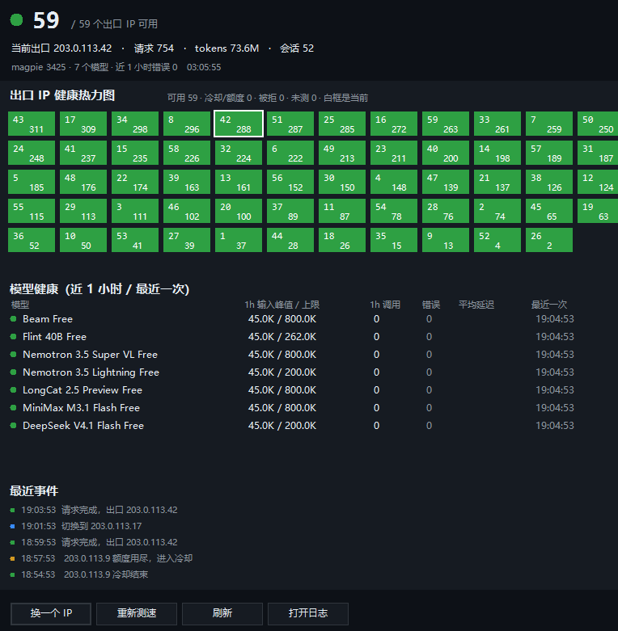

<p align="center"></p>

<h1 align="center">free-rice</h1>

<p align="center"><b>token来。</b><br>
magpie 的出口高可用：自动选择、切换、重试 Clash 出口。</p>

<p align="center"></p>

<p align="center">
  
  
  
  
</p>

free-rice 是 magpie 的出口高可用组件。它给 OpenCode Zen Free provider、WorkBuddy 等走本地代理的 provider 维护一组 Clash 出口，按 IP 记录使用情况，出口不可用时自动切换和重试。

## 它是怎么工作的

```text
客户端 / SDK
    |
    v
magpie  127.0.0.1:3425
    |
    v
provider 插件（OpenCode Zen Free、WorkBuddy 等）  (baseURL = http://127.0.0.1:7999)
    |
    v
zen-router  127.0.0.1:7999
    |
    v
mihomo  127.0.0.1:7900  ->  出口 IP  ->  上游
```

magpie 管模型列表、鉴权和统一入口；zen-router 管出口和重试；mihomo 把连接送出去。7901 给测速用，9099 是 mihomo 的控制口。所有进程只监听本机回环地址。

## 什么时候需要它

magpie 里有一个或多个走本地代理的 provider；有多个 Clash 出口；希望某个出口不可用、被限流或被地区拒绝时，请求自动换一个。

只有一个固定出口、也不关心出口状态时，不需要 free-rice。

## 绿色，数据都在一个目录

运行时、配置、状态和日志都放在 `%USERPROFILE%\.zen-ip`。删掉这个目录就干净了。

安装不写 Program Files，不改 PATH，不设系统代理，不建 Windows 服务，也不需要管理员。登录自启只是 Startup 文件夹里的两个 `.vbs`。magpie 是独立程序，它自己的配置在 `%USERPROFILE%\.config\magpie`。

想换盘用 `-DataDir`。换了目录之后设 `$env:ZEN_IP_HOME`，rice 和卸载脚本才能找到同一份数据。

## 安装

需要 Windows 10/11 和 PowerShell 7，外加一个 Clash 订阅地址或本地 YAML。

不用先 clone，直接从 GitHub 跑。最省事的是 `irm | iex`，跑起来后会问你订阅地址：

```powershell
irm https://raw.githubusercontent.com/BICHENG/free-rice/main/install.ps1 | iex
```

要带参数、不交互，用 scriptblock 形式：

```powershell
& ([scriptblock]::Create((irm https://raw.githubusercontent.com/BICHENG/free-rice/main/install.ps1))) -SubscriptionUrl "https://example.com/subscribe?token=..." -DryRun
```

脚本会下载源码、准备依赖，然后按下面的流程安装。想先看计划就加 `-DryRun`，想换目录就加 `-DataDir`。无人值守时也可以先设 `$env:FREE_RICE_SOURCE`，再用 `irm | iex`。

```powershell
cd free-rice
.\rice.cmd install -SubscriptionUrl "https://example.com/subscribe?token=..."
```

本地配置：

```powershell
.\rice.cmd install -ClashConfig .\clash.yaml
```

`rice install` 实际转给 `install.ps1`。也可以直接运行 `pwsh -NoProfile -ExecutionPolicy Bypass -File .\install.ps1 -SubscriptionUrl "..."`。

不确定会做什么时先加 `-DryRun`，它只打印计划，不写文件也不启动进程。

安装会准备运行依赖，给 magpie 装 OpenCode Zen Free 插件，把插件 baseURL 指到 zen-router，按订阅生成 mihomo 配置，启动守护和托盘，写登录自启。默认数据目录 `%USERPROFILE%\.zen-ip`。

带 `-Probe` 时会先拉起 mihomo 和转发器再测速，`-NoStart` 的话测完停掉。登录自启优先写 Startup 文件夹，目录不可写时自动改用 HKCU Run 注册表。

常用参数：

| 参数 | 作用 |
| --- | --- |
| `-DataDir <dir>` | 换数据目录 |
| `-NoStart` | 装完不启动 |
| `-SkipTray` | 不装托盘 |
| `-NoAutostart` | 不写登录自启 |
| `-GatewayPath`、`-MihomoPath` | 用已有的 magpie.exe、mihomo.exe |
| `-MinContextTokens` | 模型过滤阈值，默认 200000 |
| `-AllowModel` | 白名单，可重复，默认放行 DeepSeek |
| `-Probe` | 安装后跑节点测速和模型探测 |

## 日常命令

```powershell
rice status          # 可用 IP、当前出口、请求量
rice models          # 当前提供的模型
rice info --json     # 端点、端口、模型，给脚本读
rice rotate          # 立刻换一个出口
rice probe           # 清掉冷却，重新让 IP 参与调度
rice refresh         # 重拉订阅、重建配置、重启服务
rice doctor          # 端口、网关、插件、日志体检
rice tray            # 只启动托盘
```


## 托盘

装了托盘时，登录后自动出现。悬停看总览，左键或双击开面板，右键换 IP、测速、打开日志、退出。手动拉起用 `rice tray`。

<p align="center"></p>

开始菜单里会有 `free-rice` 文件夹，`free-rice start` 拉起守护，`free-rice tray` 拉起托盘。重复点不会开出第二份：托盘有互斥锁，守护有单实例检查，已经在跑时新进程会直接退出。

## 模型过滤

默认只提供上下文大于 200000 的免费模型，DeepSeek 通过白名单保留。GLM、MiMo 的 200k 和 Big Pickle 的 160k 默认隐藏。

```powershell
rice models allow opencode-zen-free/glm-5.3-flash-free
rice models deny opencode-zen-free/beam-free
```

改完执行 `rice refresh`。阈值和名单也在 `config.json` 的 `models` 里。

## 客户端怎么接

客户端连 magpie 的 `3425`。free-rice 不改变这些地址，只在出口侧做切换和重试。

统一入口：

| 协议 | 地址 | Key |
| --- | --- | --- |
| OpenAI | `http://127.0.0.1:3425/v1` | `magpie` |
| Anthropic | `http://127.0.0.1:3425` | `magpie` |

模型名用 `rice models` 显示的全名，例如 `opencode-zen-free/minimax-m3.1-flash-free`。

DSH：

```powershell
magpie dsh opencode-zen-free/minimax-m3.1-flash-free
```

Claude Code 用环境变量：

```powershell
$env:ANTHROPIC_BASE_URL = "http://127.0.0.1:3425"
$env:ANTHROPIC_API_KEY = "magpie"
```

Codex 在 `~/.codex/config.toml` 里把 base_url 指向 `http://127.0.0.1:3425/v1`，`wire_api = "responses"`。OpenAI SDK 用 base_url `http://127.0.0.1:3425/v1` 和 api_key `magpie`。其他 OpenAI 兼容客户端照填 base_url、key 和模型名。

验证一次：

```powershell
$body = '{"model":"opencode-zen-free/minimax-m3.1-flash-free","messages":[{"role":"user","content":"只回复 OK"}],"max_tokens":64}'
(Invoke-RestMethod -Uri http://127.0.0.1:3425/v1/chat/completions -Method Post -Headers @{ Authorization = "Bearer magpie" } -ContentType "application/json" -Body $body -NoProxy).choices[0].message.content
```

## 限制

免费层的规则由上游决定：上下文、输出上限、请求量和地区限制都不由本地控制，具体额度以官方为准。出口切换只影响请求从哪个 IP 出去，不会增加账号额度，也不会扩大模型上下文。


## 卸载

```powershell
rice uninstall            # 停进程，删启动项，保留数据
rice uninstall -Purge     # 连数据目录一起删
rice uninstall -KeepGateway  # 保留 magpie 网关
```
